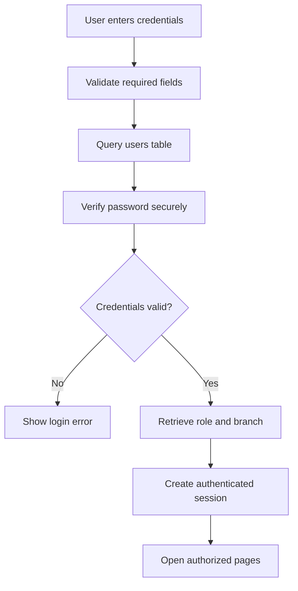
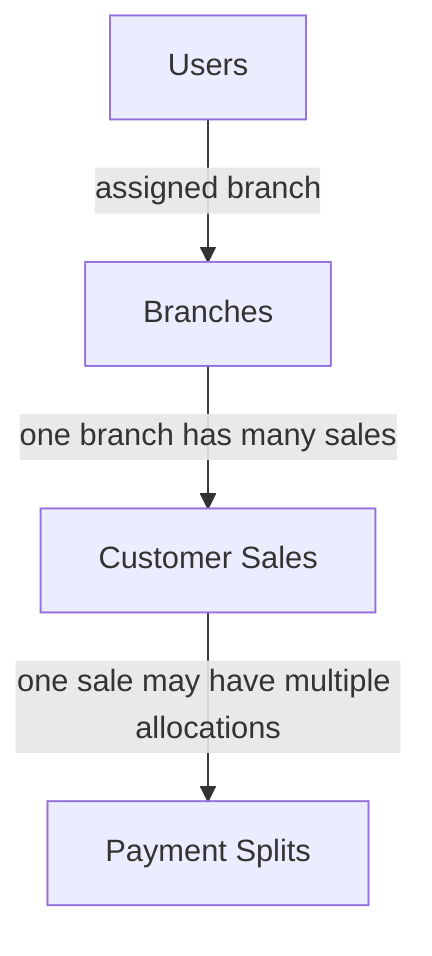
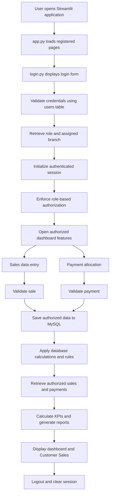

SALES MANAGEMENT SYSTEM
Complete Project Documentation
Streamlit · Python · MySQL · Pandas

Multi-Branch Sales Management and Business Analytics

Table of Contents
1. Project Overview
2. Technology Stack
3. Streamlit Application Development
4. Login Module
5. Role-Based Access Control
6. Dashboard Features
7. Insights and Reporting
8. MySQL Database Design and Management
9. Complete Application Pipeline
10. Testing and Validation
11. Security Requirements
12. Deployment Pipeline
13. Project Deliverables
14. Conclusion
1. Project Overview
The Sales Management System is a centralized web application developed using Python and Streamlit, with MySQL as its database management system. It enables businesses to manage sales entries, customer records, payment allocations, pending collections, and financial reports across multiple branches.

The application implements role-based access control with two user roles: Super Admin and Admin. The Super Admin can monitor and manage sales information across all branches, whereas each Admin is restricted to their assigned branch.
1.1 Project Objectives
- Develop a centralized dashboard for multi-branch sales management.
- Implement secure login and session-based authentication.
- Provide role-based permissions for Super Admin and Admin users.
- Record sales entries and payment split details.
- Track received amounts and outstanding payments.
- Generate branch-wise and overall financial reports.
- Execute predefined SQL queries for business analysis.
- Automate financial calculations using MySQL triggers and generated columns where configured.
- Improve monitoring of branch performance and business revenue.
2. Technology Stack
Component	Technology
Programming language	Python
Frontend and dashboard	Streamlit
Database	MySQL
Database connectivity	mysql.connector
Data processing	Pandas
Authentication	Database-backed credential validation and Streamlit session state
Reporting	Streamlit tables, metrics, filters, and charts
Database automation	MySQL triggers and generated columns, where implemented

3. Streamlit Application Development
The application is developed as a centralized Streamlit dashboard that provides sales management, reporting, and data-entry functionality based on the authenticated user's role.
3.1 Application Structure
Streamlit-Project/
├── app.py
├── login.py
├── project.py
├── c.sales.py
└── .streamlit/
    └── secrets.toml
- app.py — Main application entry point; registers pages and manages navigation.
- login.py — Login interface, credential validation, session initialization, and logout handling.
- project.py — Dashboard, sales reports, financial KPIs, filters, sales entry, payment operations, and authorized SQL functionality.
- c.sales.py — Customer Sales table with role-based record filtering.
- .streamlit/secrets.toml — Database connection configuration stored outside the application source code.
3.2 Centralized Dashboard
The dashboard supports the following functional areas:
- Sales entry and management.
- Payment split allocation.
- Sales reports.
- Pending payment monitoring.
- Sales status analysis.
- Payment method summaries.
- Financial KPI monitoring.
- Branch-wise business analytics.
- Predefined SQL query execution.
The dashboard must apply the user's access permissions consistently to every applicable feature.
4. Login Module — Mandatory
The Login Module controls access to the Sales Management System. Users must authenticate successfully before accessing protected application pages or business data.
4.1 Username and Password Authentication
1. Accept the user's login credentials.
2. Validate the credentials against the users table in MySQL.
3. Reject invalid usernames or passwords.
4. Retrieve the user's assigned role and branch information after successful authentication.
5. Establish the authenticated session.
6. Allow access only to authorized application pages.
Passwords should be stored securely using an appropriate password-hashing mechanism rather than plaintext storage.
4.2 Database-Based Credential Validation
The users table is the source of authentication information. Its precise column names and password-storage format must match the database schema. Database queries must use parameterized inputs to reduce SQL injection risk.

4.3 Session-Based Login Management
The application may maintain these session values after successful authentication:
- logged_in — Authentication status.
- username — Authenticated username.
- role — Assigned role.
- branch_id — Assigned branch identifier.
The application checks authentication before rendering protected pages and executing sensitive database operations.
4.4 Logout Functionality
1. End the authenticated session.
2. Clear or invalidate relevant authentication state.
3. Return the user to the login page.
4. Prevent access to protected features until the user logs in again.
4.5 Unauthorized Access Prevention
Unauthenticated users must not access dashboards, sales records, payment details, or SQL execution features.

Authorization must be enforced on each protected page and during database operations; hiding navigation items alone is insufficient.
5. Role-Based Access Control
5.1 Super Admin
The Super Admin is intended to have organization-wide access to authorized functionality:
- View sales records across all branches.
- Create sales entries for any branch.
- View payment split details across all branches.
- Add or manage payment split records across branches, subject to the implemented workflow.
- View overall business revenue and financial KPIs.
- Compare branch performance.
- Monitor pending payments across the organization.
- Analyze payment methods and sales statuses.
- Access complete business analytics and reports.
- Execute authorized predefined SQL queries.
5.2 Admin
Each Admin is restricted to the assigned branch:
- Create sales entries only for the assigned branch.
- Add payment split records only for sales belonging to that branch.
- View sales records belonging to the assigned branch.
- Track pending payments for the assigned branch.
- View branch-specific financial KPIs and reports.
- Monitor Open and Close sales statuses for the assigned branch.
- View payment method summaries for the assigned branch.
- Access only approved SQL queries and results permitted for the Admin role.
5.3 Role and Permission Matrix
Functionality	Super Admin	Admin
View all branches	Yes	No
Create sales for any branch	Yes	No
Create sales for assigned branch	Yes	Yes
View all sales records	Yes	No
View assigned branch sales	Yes	Yes
View all payment splits	Yes	No
Add payment splits for any branch	If authorized	No
Add payment splits for assigned branch	Yes	Yes
Organization-wide pending payments	Yes	No
Branch-specific pending payments	Yes	Yes
Organization-wide financial KPIs	Yes	No
Branch-specific financial KPIs	Yes	Yes
Branch-wise comparison report	Yes	No
Branch-specific analytics	Yes	Yes
Advanced SQL functionality	Authorized queries	Restricted to approved queries

5.4 Branch-Level Data Security
Every Admin must be restricted to their assigned branch_id. For example, a Chennai Admin must not retrieve Delhi or Bangalore records by changing filters, navigation, or SQL input. Branch assignment must be derived from trusted authentication data and validated on the server.

Key principle: The Super Admin can create and view data for all branches; an Admin can create and view data only for their respective branch.
6. Dashboard Features
6.1 Add a New Sales Entry
- Record branch, sale date, customer name, mobile number, product name, gross sales, received amount, and status as applicable.
- Validate required fields and numeric values before saving.
- Allow Super Admin to choose any authorized branch.
- Derive or validate the branch for Admin users from their authenticated session.
- Save valid entries to MySQL and refresh the relevant reports.
6.2 Add Payment Split Records
- Select an existing sale and enter the payment amount.
- Choose Cash, UPI, or Card and provide other required details.
- Validate the allocation and sale association.
- Save payment split records to MySQL.
- Recalculate or refresh received and pending amounts according to the implemented rules.
6.3 View Sales Reports
- Provide sales reports with branch, product, date range, and status filters where available.
- Allow Super Admin to analyze records across branches.
- Restrict Admin reports to the assigned branch.
6.4 Branch Filter
- Super Admin can select any available branch or all branches.
- Admin users must remain restricted to their assigned branch.
- Tables, metrics, and charts must reflect the authorized filtered dataset.
6.5 Pending Payment Monitoring
- Calculate pending amount using gross sales minus received amount, subject to the payment allocation rules.
- Identify outstanding collections.
- Avoid double-counting payment split records.
6.6 Sales Status — Open vs Close
- Display and filter Open and Close sales statuses.
- Apply the business rules that define when a sale is considered closed.
6.7 Payment Method Summary
- Summarize payments through Cash, UPI, and Card.
- Allow organization-wide comparison for Super Admin and branch-level analysis for Admin.
6.8 Predefined SQL Query Execution — Mandatory
The application includes a SQL query interface for executing approved, predefined business queries. The interface should provide query selection, query categories where configured, execution, result display, and safe error handling.

Expected query topics include:
- Total sales by branch.
- Total received and pending amounts.
- Sales by product.
- Open versus Closed sales.
- Payment method summaries.
- Branch-wise revenue comparison.
- Date-based sales trends.
The SQL Engine must use appropriate database permissions and controlled query execution. Admin users must not bypass branch restrictions by editing SQL or executing unrestricted queries.
6.9 Financial KPI Summary
- Total Gross Sales: Sum of gross sales amounts for the authorized reporting period and dataset.
- Total Received Amount: Total customer payments received, calculated consistently with payment records and allocation rules.
- Total Pending Amount: Outstanding amount calculated according to the sales and payment records.
- Pending Collection Percentage: Pending Amount divided by Total Gross Sales, multiplied by 100.
\[
\text{Pending Collection \%} =
\frac{\text{Total Pending Amount}}{\text{Total Gross Sales}} \times 100
\]
If total gross sales is zero, the application must handle the calculation safely. All KPIs must respect user permissions and active filters.
7. Insights and Reporting
7.1 Overall Business Revenue
Monitor total gross sales across the organization and analyze available date ranges, branches, and products.
7.2 Branch-Wise Sales Comparison
Compare gross sales, received amounts, pending amounts, sales counts, and collection percentages across branches.
7.3 Received vs Pending Amount
Compare collections with outstanding payments using consistent calculations that avoid double-counting.
7.4 Pending Collection Percentage
Measure the proportion of gross sales that remains outstanding and identify collection follow-up needs.
7.5 Payment Method Analysis
Analyze Cash, UPI, and Card totals and their contribution to collections.
7.6 Sales Trends and Growth Tracking
Analyze daily or monthly sales, period-over-period comparisons, branch trends, and product trends.
7.7 Branch Performance Summary
Provide a consolidated view of revenue, received amount, pending amount, collection percentage, sales volume, and payment method distribution.

Super Admin can compare all branches; Admin users can view only the corresponding metrics for their assigned branch.
8. MySQL Database Design and Management
8.1 Users Table
Stores authentication and role assignment information. Expected logical fields may include a user identifier, username, password hash, role, branch identifier, and account status if supported. Actual column names and password verification must match the implementation.
8.2 Branches Table
Maintains branch details. Known fields include:
- branch_id
- branch_name
8.3 Customer Sales Table
Stores customer sales records. Known fields include:
Field	Description
sale_id	Sale identifier
branch_id	Associated branch
dates	Sale date
name	Customer name
mobile_number	Customer contact number
product_name	Product sold
gross_sales	Gross sale value
recieved_amount	Amount received
status	Sale status

Schema note: The current database uses the spelling recieved_amount. Queries must use the actual column name unless the schema is deliberately changed.

8.4 Payment Splits Table
Stores individual payment allocations associated with sales. The known payment amount field is amount_paid. Foreign keys, payment method, transaction identifiers, and date fields must be verified from the live schema.
8.5 Logical Database Relationships
The following diagram illustrates the intended logical relationships. Verify exact foreign-key constraints and cardinality against the implemented database.

8.6 MySQL Triggers and Generated Columns
The system requirements include automated financial calculations using triggers and generated columns where appropriate. Triggers can execute database logic on defined events such as inserts or updates. Generated columns derive values from other columns within the same row, subject to MySQL restrictions. Definitions must be checked against the database scripts.
9. Complete Application Pipeline

9.1 Data Flow
1. The user submits a request through the Streamlit interface.
2. The application validates the input and the user's permissions.
3. The application executes a parameterized SQL operation.
4. MySQL retrieves or updates the relevant records.
5. Python and Pandas process the returned data.
6. Streamlit displays the resulting table, KPI, chart, or message.
10. Testing and Validation
Test scenario	Expected outcome
Valid Super Admin login	Access to authorized organization-wide features
Valid Admin login	Access to assigned branch features
Invalid login	Access denied
Protected page opened without login	Access denied or redirected
Super Admin creates sale for another branch	Allowed
Admin attempts sale for another branch	Rejected
Super Admin views customer sales	All authorized branch records displayed
Admin views customer sales	Only assigned branch records displayed
Admin accesses another branch payment split	Rejected
Payment split is recorded	Correct sale association and amount
Dashboard calculates pending amounts	Consistent with payment allocation rules
Dashboard filters are applied	Metrics and reports reflect authorized records
SQL Engine executes approved query	Correct results displayed
Admin attempts unauthorized SQL operation	Rejected
Logout is performed	Session ends and protected access is blocked
Database connection fails	Safe and understandable error is displayed

Testing should also cover boundary conditions, duplicate submissions, missing data, zero sales totals, and multiple payments for the same sale.
11. Security Requirements
- Store password hashes rather than plaintext passwords.
- Use parameterized SQL queries.
- Enforce authorization on the server and in database operations.
- Restrict Admin access to the assigned branch.
- Prevent SQL editing or navigation from bypassing role restrictions.
- Keep database credentials in Streamlit secrets or another secure configuration mechanism.
- Avoid exposing credentials or sensitive details in error messages.
- Validate amounts, dates, branch identifiers, and payment allocations.
- Use transactions for operations involving multiple related database writes.
- Verify authentication before rendering protected pages.
- Clear authentication state on logout.
- Restrict predefined SQL execution to approved operations and authorized data.
12. Deployment Pipeline
1. Complete development of the Streamlit application.
2. Validate the database schema and relationships.
3. Configure the MySQL connection.
4. Install required Python packages.
5. Configure secrets securely in the deployment environment.
6. Test authentication and role-based access.
7. Validate sales entry and payment split operations.
8. Verify financial KPIs and reports against database results.
9. Test predefined SQL queries and authorization rules.
10. Deploy the application to the selected hosting environment.
11. Verify live database connectivity.
12. Configure database backups, monitoring, and error handling.
Local launch command
streamlit run app.py
Secrets configuration
Create .streamlit/secrets.toml locally and configure the database credentials using the keys expected by the application. Do not commit real credentials to GitHub.

Example .gitignore entries:
.streamlit/secrets.toml
.env
.venv/
__pycache__/
*.py[cod]
13. Project Deliverables
- Centralized Streamlit application.
- Secure login and logout module.
- Role-based access for Super Admin and Admin.
- Branch-restricted sales entry.
- Payment split allocation and tracking.
- Customer Sales table with branch-level filtering.
- Financial KPI dashboard.
- Sales status and payment method analysis.
- Predefined SQL query execution.
- Business insights and reporting.
- MySQL database schema and relevant database automation.
- Testing results for functionality and access control.
- Technical documentation and deployment instructions.
14. Conclusion
The Sales Management System provides a centralized platform for monitoring sales operations, payment collections, and financial performance across multiple branches. It combines Streamlit for interactive dashboards, Python and Pandas for data processing, and MySQL for structured data storage and querying.

Its key objectives are secure authentication, branch-specific access control, accurate payment tracking, automated financial calculations, predefined SQL analytics, and actionable business reporting. The Super Admin receives an organization-wide view, while each Admin is restricted to the assigned branch.
Implementation Status Note
This document defines the required system functionality and the known project structure. Each mandatory requirement should be verified against the latest Python source files, MySQL schema, trigger definitions, and test results before the project is described as fully implemented.

Sales Management System · Technical Documentation

