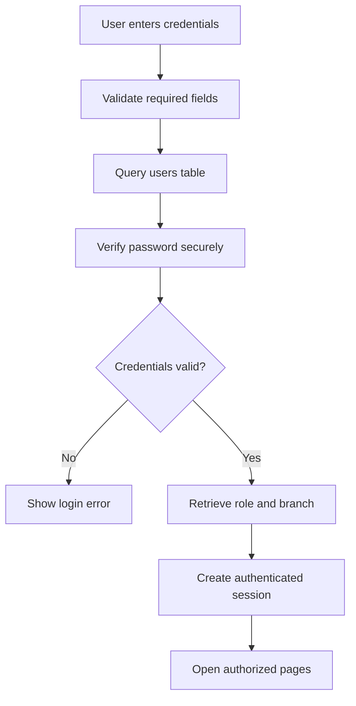
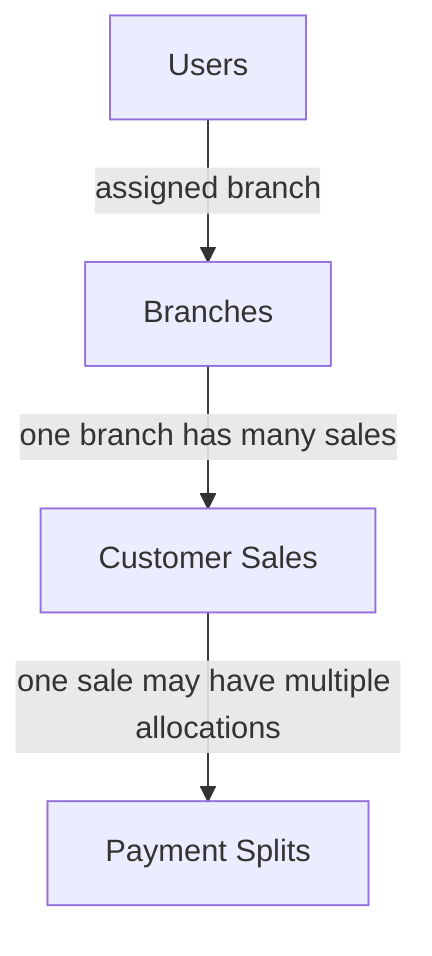
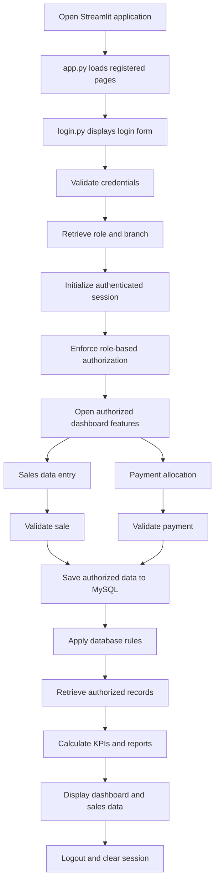

📊 SALES MANAGEMENT SYSTEM
Multi-Branch Sales Operations & Business Analytics
Complete Project Documentation

  
  
  
  

Centralized sales records · Branch-level access · Collection tracking · Financial reporting

📑 Table of Contents

<strong>View project documentation</strong>

- 1. Project Overview
- 2. Technology Stack
- 3. Streamlit Application Development
- 4. Login Module
- 5. Role-Based Access Control
- 6. Dashboard Features
- 7. Insights and Reporting
- 8. MySQL Database Design and Management
- 9. Complete Application Pipeline
- 10. Testing and Validation
- 11. Security Requirements
- 12. Deployment Pipeline
- 13. Project Deliverables
- 14. Conclusion

1. Project Overview
The Sales Management System is a centralized web application developed using Python and Streamlit, with MySQL as its database management system. It supports sales entry, customer records, payment allocations, pending collections, and financial reporting across multiple branches.

The system is designed around two access levels:
- Super Admin — organization-wide visibility and authorized operations across branches.
- Admin — access restricted to the branch assigned to the account.
🎯 Project Objectives
Objective	Purpose
Centralized sales management	Maintain sales information in one system
Secure authentication	Restrict access to authorized users
Role-based permissions	Separate Super Admin and Admin capabilities
Payment allocation	Record and track payment splits
Collection monitoring	Identify received and pending amounts
Financial reporting	Provide branch-wise and overall summaries
SQL business analysis	Run approved queries for reporting
Database automation	Use triggers/generated columns where implemented

[!NOTE]
Verify each feature against the latest application code and database schema before presenting it as implemented.

2. Technology Stack
Component	Technology	Responsibility
Programming language	Python	Application logic
Dashboard and UI	Streamlit	User interface, pages, filters, and metrics
Database	MySQL	Persistent relational storage
Database connectivity	mysql.connector	Connect Python to MySQL
Data processing	Pandas	Query result processing and analysis
Authentication	MySQL + Streamlit session state	Credential validation and session handling
Reporting	Streamlit tables, metrics, filters, and charts	Display business information
Database automation	Triggers/generated columns, where implemented	Apply configured database rules

3. Streamlit Application Development
The application provides sales management, reporting, and data-entry functionality according to the authenticated user's role.
3.1 Application Structure
Streamlit-Project/
├── app.py
├── login.py
├── project.py
├── c.sales.py
└── .streamlit/
    └── secrets.toml
File	Responsibility
app.py	Application entry point, registered pages, and navigation
login.py	Login interface, credential validation, session setup, and logout
project.py	Dashboard, sales reports, financial KPIs, filters, sales entry, payment operations, and SQL functionality
c.sales.py	Customer Sales table and role-based record filtering
.streamlit/secrets.toml	Local database configuration; must not be committed to source control

3.2 Centralized Dashboard
The dashboard's functional areas include:
- Sales entry and management
- Payment split allocation
- Sales reports
- Pending payment monitoring
- Sales status analysis
- Payment method summaries
- Financial KPI monitoring
- Branch-wise business analytics
- Predefined SQL query execution
All applicable features must consistently enforce the user's access permissions.
4. Login Module — Mandatory
The Login Module controls access to protected pages and business data.
4.1 Username and Password Authentication
1. Accept the user's credentials.
2. Validate them against the users table in MySQL.
3. Reject invalid credentials.
4. Retrieve the assigned role and branch information after successful authentication.
5. Establish the authenticated session.
6. Permit access only to authorized application features.
Security requirement: Store passwords using an appropriate password-hashing mechanism rather than as plaintext.
4.2 Database-Based Credential Validation
The users table provides authentication information. Its column names and password-storage format must match the actual database schema. Use parameterized queries for user-supplied values.

4.3 Session-Based Login Management
The application may maintain these session values after successful authentication:
Session key	Purpose
logged_in	Authentication status
username	Authenticated username
role	Assigned role
branch_id	Assigned branch identifier

Check authentication before rendering protected pages and before executing sensitive database operations.
4.4 Logout Functionality
1. End the authenticated session.
2. Clear or invalidate relevant authentication state.
3. Return the user to the login page.
4. Block protected access until the user signs in again.
4.5 Unauthorized Access Prevention
Unauthenticated users must not access dashboards, sales records, payment details, or SQL execution features. Authorization must be enforced on protected pages and database operations; hiding navigation items alone is not sufficient.
5. Role-Based Access Control
5.1 Super Admin
The Super Admin is intended to have organization-wide access to authorized functionality:
- View sales records across all branches.
- Create sales entries for any branch.
- View payment split details across branches.
- Manage payment split records where authorized.
- View overall revenue and financial KPIs.
- Compare branch performance.
- Monitor organization-wide pending payments.
- Analyze payment methods and sales statuses.
- Access business analytics and reports.
- Execute authorized predefined SQL queries.
5.2 Admin
Each Admin is restricted to the assigned branch:
- Create sales entries for the assigned branch only.
- Add payment split records for sales belonging to that branch.
- View the assigned branch's sales records.
- Track branch-level pending payments.
- View branch-specific financial KPIs and reports.
- Monitor Open and Close statuses.
- View branch-level payment method summaries.
- Access only approved SQL queries and results.
5.3 Role and Permission Matrix
Functionality	Super Admin	Admin
View all branches	Yes	No
Create sales for any branch	Yes	No
Create sales for assigned branch	Yes	Yes
View all sales records	Yes	No
View assigned branch sales	Yes	Yes
View all payment splits	Yes	No
Add payment splits for any branch	If authorized	No
Add payment splits for assigned branch	Yes	Yes
Organization-wide pending payments	Yes	No
Branch-specific pending payments	Yes	Yes
Organization-wide financial KPIs	Yes	No
Branch-specific financial KPIs	Yes	Yes
Branch-wise comparison report	Yes	No
Branch-specific analytics	Yes	Yes
Advanced SQL functionality	Approved queries	Restricted queries

5.4 Branch-Level Data Security
Every Admin must be restricted to their assigned branch_id. For example, a Chennai Admin must not retrieve Delhi or Bangalore records by changing filters, navigation, or SQL input. Branch assignment must come from trusted authentication data and be validated on the server.
Core access rule: Super Admin can create and view data across all branches. An Admin can create and view data only for their assigned branch.

6. Dashboard Features
6.1 Add a New Sales Entry
- Record branch, sale date, customer name, mobile number, product, gross sales, received amount, and status as applicable.
- Validate required fields and numeric values.
- Allow Super Admin to select any authorized branch.
- Derive or validate the branch for Admin users from their authenticated session.
- Save valid entries to MySQL and refresh relevant reports.
6.2 Add Payment Split Records
- Select an existing sale and enter the payment amount.
- Choose Cash, UPI, or Card and provide other required details.
- Validate the allocation and sale association.
- Save payment split records to MySQL.
- Refresh received and pending amounts according to the implemented rules.
6.3 View Sales Reports
- Filter by branch, product, date range, and status where available.
- Allow Super Admin to analyze records across branches.
- Restrict Admin reports to the assigned branch.
6.4 Branch Filter
- Super Admin can select any available branch or all branches.
- Admin users remain restricted to their assigned branch.
- Tables, metrics, and charts must reflect the authorized filtered dataset.
6.5 Pending Payment Monitoring
- Calculate pending amount using gross sales minus received amount, subject to payment allocation rules.
- Identify outstanding collections.
- Avoid double-counting payment split records.
6.6 Sales Status — Open vs Close
Display and filter Open and Close statuses using the business rules that define when a sale is considered closed.
6.7 Payment Method Summary
Summarize Cash, UPI, and Card payments. Super Admin can compare branches; Admin users see their assigned branch's information.
6.8 Predefined SQL Query Execution — Mandatory
The SQL query interface is intended to execute approved, predefined business queries. It should support query selection, categories where configured, execution, result display, and safe error handling.

Expected query topics include:
- Total sales by branch
- Total received and pending amounts
- Sales by product
- Open versus Closed sales
- Payment method summaries
- Branch-wise revenue comparison
- Date-based sales trends
The SQL Engine must use appropriate database permissions and controlled query execution. Admin users must not bypass branch restrictions by editing SQL or executing unrestricted queries.
6.9 Financial KPI Summary
KPI	Definition
Total Gross Sales	Sum of gross sales for the authorized dataset and reporting period
Total Received Amount	Customer payments received, calculated consistently with payment records
Total Pending Amount	Outstanding amount calculated according to sales and payment rules
Pending Collection Percentage	Pending amount divided by gross sales, multiplied by 100

\[
\text{Pending Collection \%} =
\frac{\text{Total Pending Amount}}{\text{Total Gross Sales}} \times 100
\]
Handle zero gross sales safely. Every KPI must respect user permissions and active filters.
7. Insights and Reporting
Report / Insight	Business value
Overall business revenue	Monitor gross sales across the organization
Branch-wise sales comparison	Compare revenue, collections, and pending amounts by branch
Received vs. pending amount	Understand collections and outstanding balances
Pending collection percentage	Measure the share of sales still outstanding
Payment method analysis	Analyze Cash, UPI, and Card contributions
Sales trends and growth	Review daily/monthly performance and product trends
Branch performance summary	Consolidate revenue, collections, pending amounts, and sales volume

Super Admin can compare all branches. Admin users can view only the metrics for their assigned branch.
8. MySQL Database Design and Management
8.1 Users Table
Stores authentication and role assignment information. Expected logical fields may include a user identifier, username, password hash, role, branch identifier, and account status where supported. Actual column names must match the implementation.
8.2 Branches Table
Field	Purpose
branch_id	Branch identifier
branch_name	Branch name displayed in the application

8.3 Customer Sales Table
Field	Purpose
sale_id	Sale identifier
branch_id	Associated branch
dates	Sale date
name	Customer name
mobile_number	Customer contact number
product_name	Product sold
gross_sales	Gross sale value
recieved_amount	Amount received
status	Sale status

Schema note: The known database spelling is recieved_amount. SQL queries must use the actual column name unless the schema is deliberately changed.

8.4 Payment Splits Table
Stores individual payment allocations associated with sales. The known payment amount field is amount_paid. Verify foreign keys, payment method, transaction identifiers, and date fields against the live schema.
8.5 Logical Database Relationships
The following diagram represents the intended logical relationships. Verify the actual foreign-key constraints and cardinality against the database.

8.6 MySQL Triggers and Generated Columns
The requirements include automated financial calculations using triggers and generated columns where appropriate. Triggers execute database logic on defined events; generated columns derive values from other columns in the same row, subject to MySQL restrictions. Verify the actual definitions against the database scripts.
9. Complete Application Pipeline

9.1 Data Flow
1. The user submits a request through the Streamlit interface.
2. The application validates the input and user permissions.
3. A parameterized SQL operation is executed.
4. MySQL retrieves or updates the relevant records.
5. Python and Pandas process the returned data.
6. Streamlit displays the resulting table, KPI, chart, or message.
10. Testing and Validation
Test scenario	Expected outcome
Valid Super Admin login	Access to authorized organization-wide features
Valid Admin login	Access to assigned branch features
Invalid login	Access denied
Protected page opened without login	Access denied or redirected
Super Admin creates a sale for another branch	Allowed
Admin attempts a sale for another branch	Rejected
Super Admin views customer sales	All authorized branch records displayed
Admin views customer sales	Only assigned branch records displayed
Admin accesses another branch's payment split	Rejected
Payment split is recorded	Correct sale association and amount
Pending amounts are calculated	Consistent with payment allocation rules
Dashboard filters are applied	Metrics and reports reflect authorized records
Approved SQL query executes	Correct results displayed
Admin attempts unauthorized SQL	Rejected
Logout is performed	Session ends and protected access is blocked
Database connection fails	Safe, understandable error is displayed

Testing should also cover boundary conditions, duplicate submissions, missing data, zero sales totals, and multiple payments for the same sale.
11. Security Requirements
- Store password hashes rather than plaintext passwords.
- Use parameterized SQL queries.
- Enforce authorization in server-side logic and database operations.
- Restrict Admin access to the assigned branch.
- Prevent SQL editing or navigation from bypassing role restrictions.
- Store database credentials in Streamlit secrets or a secure configuration service.
- Avoid exposing credentials or sensitive details in error messages.
- Validate amounts, dates, branch identifiers, and payment allocations.
- Use transactions for operations involving multiple related database writes.
- Verify authentication before rendering protected pages.
- Clear authentication state on logout.
- Restrict SQL execution to approved operations and authorized data.
12. Deployment Pipeline
1. Complete application development.
2. Validate the database schema and relationships.
3. Configure the MySQL connection.
4. Install required Python packages.
5. Configure secrets securely in the deployment environment.
6. Test authentication and role-based access.
7. Validate sales entry and payment split operations.
8. Verify KPIs and reports against database results.
9. Test SQL queries and authorization rules.
10. Deploy to the selected hosting environment.
11. Verify live database connectivity.
12. Configure database backups, monitoring, and error handling.
Run locally
streamlit run app.py
Secrets configuration
Create .streamlit/secrets.toml locally and configure database credentials using the keys expected by the application. Never commit real credentials to GitHub.

Recommended .gitignore entries:
.streamlit/secrets.toml
.env
.venv/
__pycache__/
*.py[cod]
13. Project Deliverables
- Centralized Streamlit application
- Login and logout module
- Role-based access for Super Admin and Admin
- Branch-restricted sales entry
- Payment split allocation and tracking
- Customer Sales table with branch-level filtering
- Financial KPI dashboard
- Sales status and payment method analysis
- Predefined SQL query execution
- Business insights and reporting
- MySQL schema and relevant database automation
- Functionality and access-control testing
- Technical documentation and deployment instructions
14. Conclusion
The Sales Management System provides a centralized platform for monitoring sales operations, payment collections, and financial performance across multiple branches. It combines Streamlit for interactive dashboards, Python and Pandas for data processing, and MySQL for structured data storage and querying.

Its core objectives are secure authentication, branch-specific access control, accurate payment tracking, automated financial calculations, predefined SQL analytics, and actionable business reporting. The Super Admin receives an organization-wide view, while each Admin is restricted to the assigned branch.
Implementation Status Note
This document describes the required system functionality and the known project structure. Verify each requirement against the latest Python source files, MySQL schema, trigger definitions, and test results before describing it as fully implemented.

Sales Management System
Technical Documentation · Multi-Branch Operations · Business Analytics

